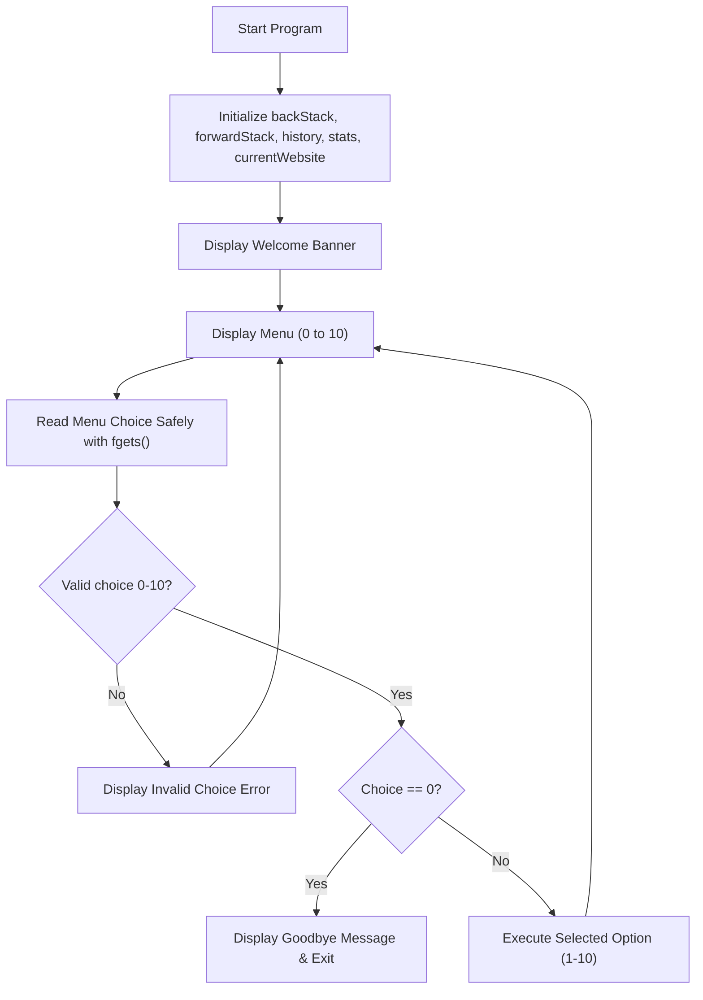
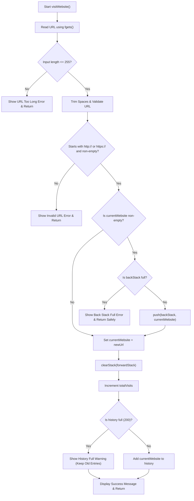
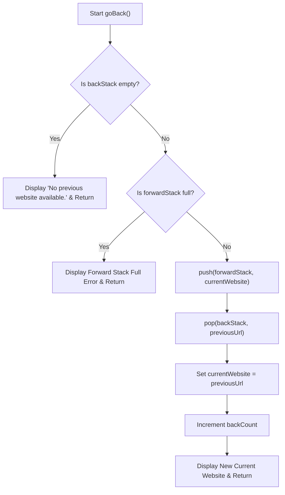
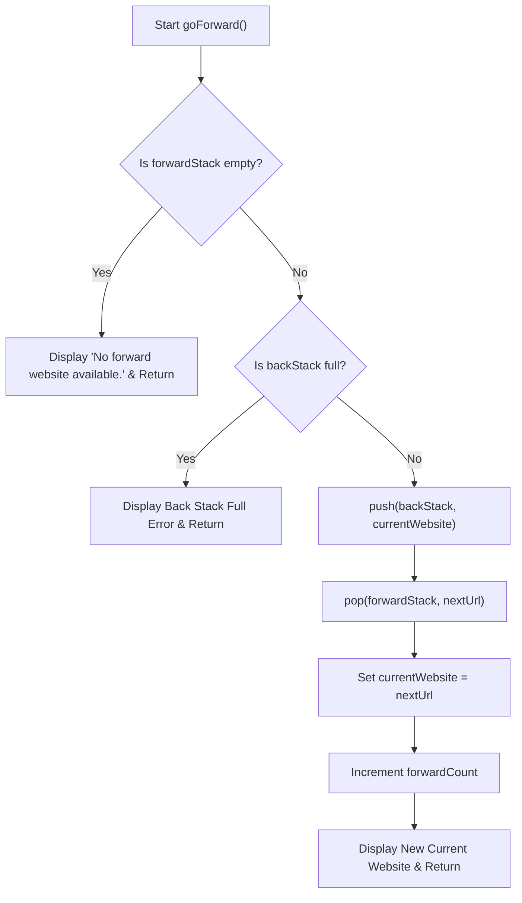

# Flowcharts – WebTrack Browser History Management System

This document contains Mermaid flowcharts for the main program loop and the three core two-stack navigation operations.

---

## 1. Main Program Flowchart

---

## 2. Visit a New Website Flowchart

---

## 3. Go Back Flowchart

---

## 4. Go Forward Flowchart

